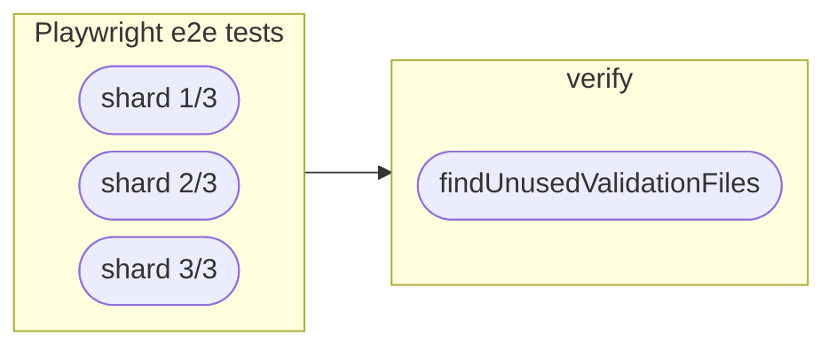

# gradle-validation-files-plugin

A Gradle plugin that integrates validation files, as written by [validation-file-assertions] and
[file-snapshots], into a Gradle build.

Requirements: **Gradle 9.0+** and **Java 21+**.

## Setup

Apply the plugin to every project that holds validation files below `data/test`:

```kotlin
plugins {
  id("de.cronn.validation-files") version "<version>"
}
```

The plugin then

- reruns the tests when a validation file changes, and keeps the build cache reusable,
- deletes `data/test/output` and `data/test/tmp` on `clean`,
- fails `check` for validation files that no test wrote (`findUnusedValidationFiles`),
- excludes `data/test/output` and `data/test/tmp` from the IntelliJ module.

The plugin hooks into the `check` and `clean` tasks of the project, no matter whether a plugin such
as `java` or the build script registers them. It does not register them itself.

Continue with the section for your kind of project.

## Backend projects

Projects with JUnit tests and [validation-file-assertions] need no further configuration: every
`Test` task is picked up.

`findUnusedValidationFiles` hooks into the standard lifecycle: it is part of `check`, and with it
of `build`, and runs after the tests. A CI pipeline that runs `./gradlew build` or
`./gradlew check` therefore checks for unused validation files without any further change.

The check is skipped when the tests are filtered with `--tests`, since the output of a partial run
does not show which files are unused.

## Frontend projects

Vitest and Playwright tests with [file-snapshots] run in tasks of the [gradle-pnpm-plugin], which
have to be registered with `producedBy`.

### Vitest

`vitestTest` is part of `check`, so registering it is all it takes:

```kotlin
validationFiles {
  producedBy(tasks.named("vitestTest"))
}
```

`./gradlew check` then runs `vitestTest`, then `findUnusedValidationFiles`.

### Playwright

`playwrightTest` is not part of `check`, since it needs a running application. By default,
however, `findUnusedValidationFiles` is part of `check` and runs all registered tests first, so
`check` would start `playwrightTest`. In mode `MANUAL` (see
[When findUnusedValidationFiles runs](#when-findunusedvalidationfiles-runs)),
`findUnusedValidationFiles` only runs when called:

```kotlin
import de.cronn.validationfiles.UnusedFileDetectionMode

validationFiles {
  producedBy(tasks.named("playwrightTest"))
  unusedFileDetection {
    mode = UnusedFileDetectionMode.MANUAL
  }
}
```

```shell
./gradlew playwrightTest findUnusedValidationFiles  # runs the tests, then checks their output
./gradlew findUnusedValidationFiles                 # checks the output of the last run
```

When the tests are sharded across CI jobs, run `findUnusedValidationFiles` in a separate job that
collects `data/test/output` of all shards:



## Configuration

### When findUnusedValidationFiles runs

`unusedFileDetection.mode` decides how `findUnusedValidationFiles` is wired into the build:

- `CHECK` (default): `findUnusedValidationFiles` is part of `check`. Suits tests that are part of
  `check` as well, such as JUnit and Vitest tests.
- `MANUAL`: `findUnusedValidationFiles` is not part of `check` and runs only when called. It does
  not run any test then, but checks the output of the last run. Suits tests that run separately,
  such as Playwright tests, and is the mode of choice for sharded tests: each CI job runs one shard,
  and a final job runs `findUnusedValidationFiles` on the collected output of all shards.

### Ignored validation files

Validation files that are only written in some runs are ignored with regular expressions, relative
to `data/test/validation`. A pattern that matches no validation file fails the check:

```kotlin
validationFiles {
  unusedFileDetection {
    ignoredFiles.add("smokeTest/.+")
  }
}
```

### Deleting unused validation files

`deleteUnusedValidationFiles` deletes the files that `findUnusedValidationFiles` reports. It runs
the tests in the same way and is skipped in the same cases.

### Skipping the check

Besides `--tests`, which is detected automatically, other partial runs skip the check with `skip`:

```kotlin
validationFiles {
  unusedFileDetection {
    skip = providers.gradleProperty("selector").map { it.isNotBlank() }
  }
}
```

### IntelliJ

The plugin applies the `idea` plugin to exclude `data/test/output` and `data/test/tmp` from the
IntelliJ module. To keep the `idea` plugin away, set the Gradle property

```properties
de.cronn.validation-files.applyIdeaPlugin=false
```

The directories are still excluded when the build applies the `idea` plugin itself.

### Directories

The location `data/test` is fixed. A project that configures a different directory for
validation-file-assertions or file-snapshots is not supported yet.

> [!NOTE]
> **TODO:** Configurable directories are planned. They need [validation-file-assertions] and
> [file-snapshots] to take the directory from the plugin, so that the plugin and the library cannot
> disagree on where the validation files are.

## Development

```shell
./gradlew build               # spotless, tests and functional tests
./gradlew spotlessApply       # formatting
./updateDependencies.sh       # update dependencies and lockfiles
```

Changes are noted by hand below `## Unreleased` in `CHANGELOG.md`. `./prepare-release.sh 1.2.3`
turns that section into the release section, commits it and tags `v1.2.3`. Pushing the tag
publishes the plugin to the Gradle Plugin Portal.

[validation-file-assertions]: https://github.com/cronn/validation-file-assertions
[file-snapshots]: https://github.com/cronn/file-snapshots
[gradle-pnpm-plugin]: https://github.com/cronn/gradle-pnpm-plugin
